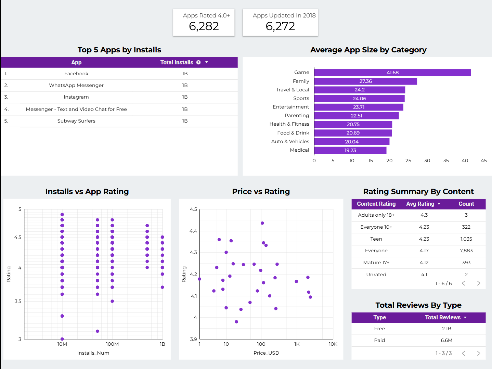
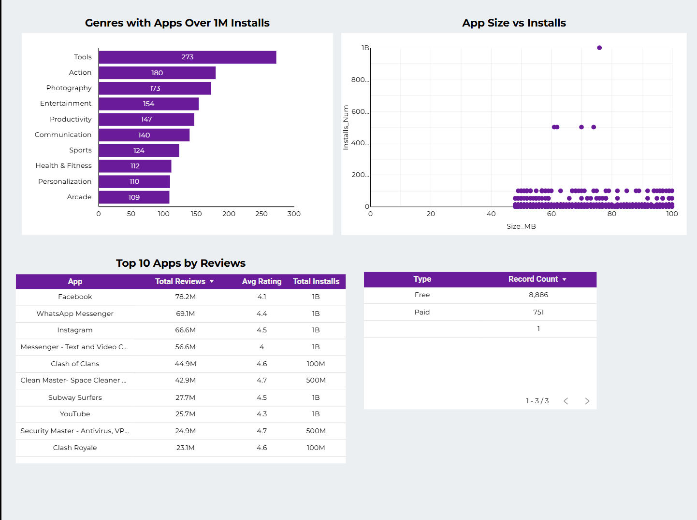
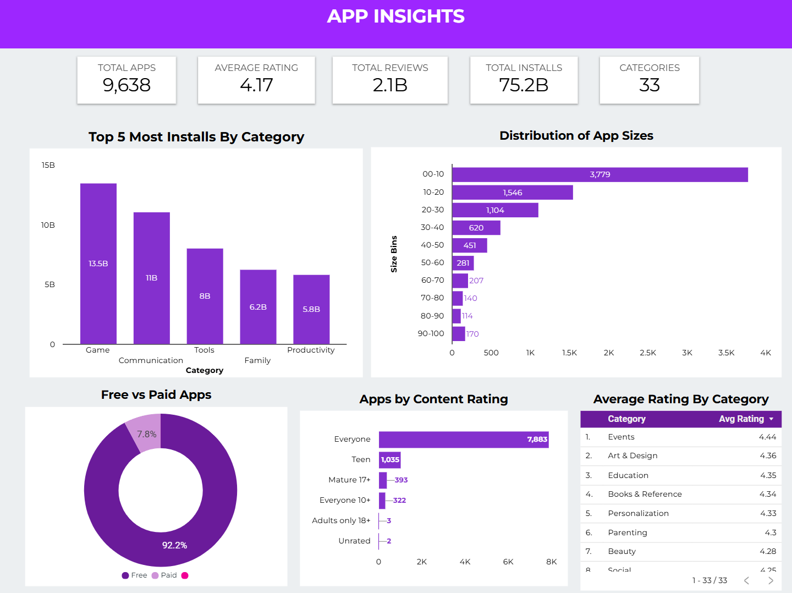
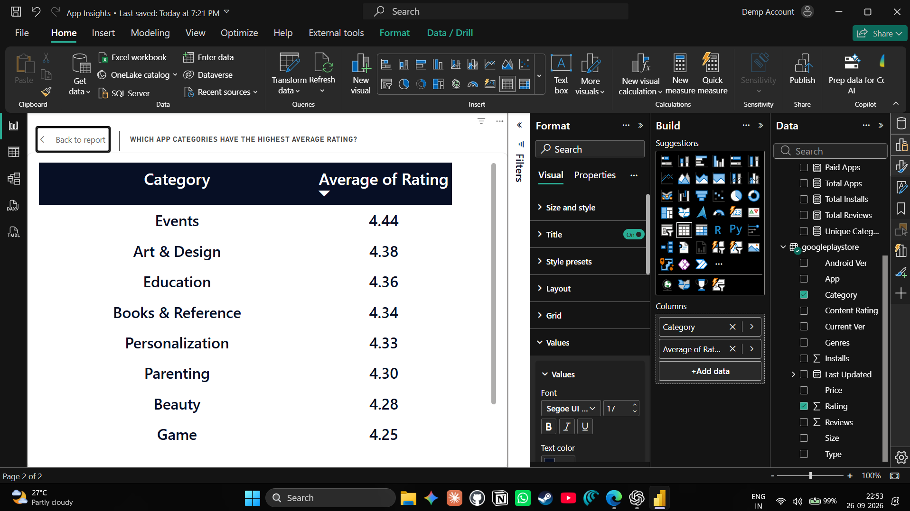
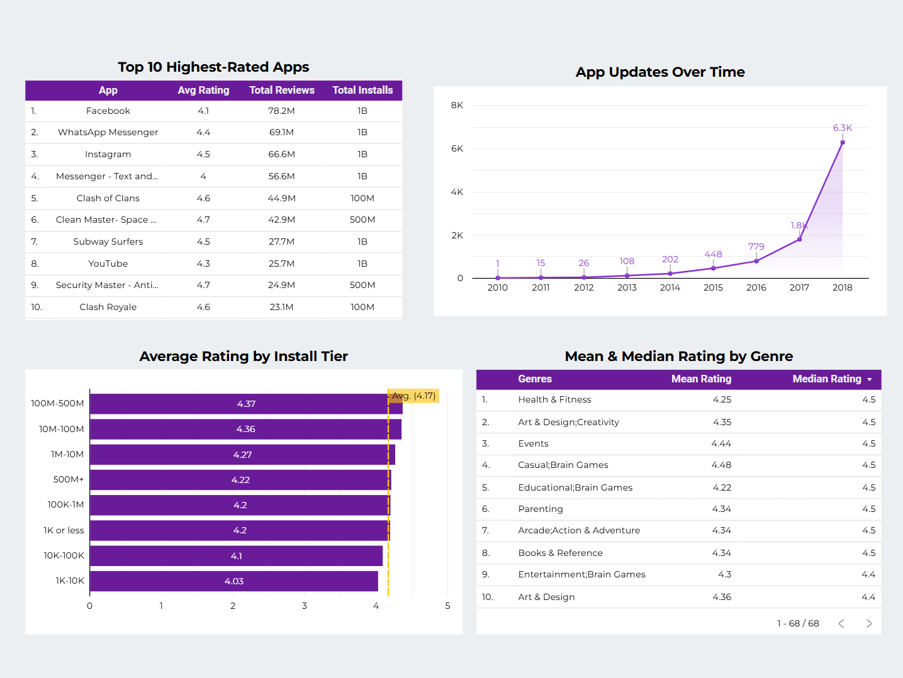

# Google Play Store App Insights — Looker Studio

This project answers the questions in the supplied App Insights case study using the Looker Studio dashboard. It uses the existing [Power BI App Insights project](https://github.com/kaushalpadole/app_insights_powerbi) as a reference when the Looker screenshots do not show a requested measure.

> **How to read the answers:** Looker findings are taken from the supplied Looker screenshots. Any Power BI reference is identified as such; it is not presented as a Looker result. Some screens use rounded display values, and the dashboards show different app totals, so figures from separate report versions should not be combined without checking the underlying data.

## Project overview

The Looker dashboard reports **9,638 apps**, **75.2 billion installs**, **2.1 billion reviews**, and an **average rating of 4.17**. It displays **33 categories**, app-size bins, a free/paid split, content-rating counts and averages, and details for highly reviewed apps.

The second Looker page includes genre counts above one million installs, app size versus installs, top-reviewed apps, and record counts by app type.

## Basic-level questions

### 1. What is the average rating of apps in the dataset?

**Answer:** The Looker dashboard reports an average rating of **4.17 out of 5**. This is the overall app-rating average; it does not imply all apps have ratings near 4.17.

### 2. How many unique categories of apps are there?

**Answer:** The Power BI reference dashboard reports **33 categories**. The Looker screenshots show category-level analysis but do not display a distinct-category KPI, so 33 is a cross-report reference rather than a value independently confirmed by the Looker pages.

### 3. What is the distribution of app sizes?

**Answer:** The Power BI reference dashboard shows **3,779 apps in the 0–10 MB bin**, 1,546 in 10–20 MB, 1,104 in 20–30 MB, 620 in 30–40 MB, 451 in 40–50 MB, 281 in 50–60 MB, 207 in 60–70 MB, 140 in 70–80 MB, 114 in 80–90 MB, and 170 in 90–100 MB. The 0–10 MB range is the largest visible bin. These are Power BI reference values; the Looker screenshot shows size versus installs, not the full size-bin distribution.

### 4. How many free vs. paid apps are there?

**Answer:** The Looker donut chart shows **92.2% free** and **7.8% paid**. Its record-count table lists **8,886 free** apps and **751 paid** apps, plus one record with no displayed type. The shares and counts are rounded/displayed values from the report.

### 5. What is the most common content rating for apps?

**Answer:** **Everyone** is the most common content rating, with **7,883 apps**. The other displayed counts are Teen (**1,035**), Mature 17+ (**393**), Everyone 10+ (**322**), Adults only 18+ (**3**), and Unrated (**2**).

### 6. What are the top 5 most installed apps?

**Answer:** The table lists **Facebook**, **WhatsApp Messenger**, **Instagram**, **Messenger – Text and Video Chat for Free**, and **Subway Surfers**. Each is displayed as having **1B installs**. Because installs are rounded to the same display value, the screenshot does not establish the exact order within the top five.

### 7. How many apps have a rating of 4.0 and above?

**Answer:** The Power BI reference screenshot reports **6,282 apps rated 4.0 or higher**. The Looker screenshots do not show this count directly.

### 8. What is the average number of reviews for free vs. paid apps?

**Answer:** The Looker table reports **2.1 billion total reviews for free apps** and **6.6 million total reviews for paid apps**. These are totals, not average reviews per app. Neither the Looker screenshots nor the Power BI reference README gives the exact averages, so this question cannot be answered precisely from the supplied reports.

### 9. What is the average app size for each category?

**Answer:** The Looker chart shows the ten categories with the largest displayed average app sizes: **Game (41.68 MB)**, **Family (27.36 MB)**, **Travel & Local (24.20 MB)**, **Sports (24.06 MB)**, **Entertainment (23.71 MB)**, **Parenting (22.51 MB)**, **Health & Fitness (20.75 MB)**, **Food & Drink (20.69 MB)**, **Auto & Vehicles (20.04 MB)**, and **Medical (19.23 MB)**. The chart shows only these ten categories, not every category in the dataset.

### 10. How many apps were last updated in 2018?

**Answer:** The Looker KPI reports **6,272 apps updated in 2018**. This is a count of app records with a 2018 last-updated date, not the number of update events during the year.

## Medium-level questions

### 1. What is the correlation between the number of installs and the app rating?

**Answer:** The scatter plot shows ratings across several install levels, with points spanning a broad rating range. It does not display a correlation coefficient or trend line, so a numerical correlation cannot be reported from the screenshot. The visual alone does not establish that installs cause higher ratings.

### 2. Which app categories have the highest average rating?

**Answer:** The Power BI reference dashboard ranks **Events (4.44)** highest, followed by **Art & Design (4.36)**, **Education (4.35)**, **Books & Reference (4.34)**, and **Personalization (4.33)**. These are reference-report values; the Looker screenshots do not show a category-average-rating ranking. See the [Power BI App Insights project](https://github.com/kaushalpadole/app_insights_powerbi) for its report and earlier analysis.

### 3. How does the price of an app affect its average rating?

**Answer:** Ratings in the Looker price plot are mostly between about **4.0 and 4.4** across the displayed price range, with a few higher or lower points. The plot does not show an obvious monotonic pattern or quantify a relationship. The Power BI reference also shows ratings varying across price points, but neither screenshot proves that price causes rating changes.

### 4. What is the distribution of app ratings across different content ratings?

**Answer:** The Looker table reports **Adults only 18+ (4.30; 3 apps)**, **Everyone 10+ (4.23; 322)**, **Teen (4.23; 1,035)**, **Everyone (4.17; 7,883)**, **Mature 17+ (4.12; 393)**, and **Unrated (4.10; 2)**. It presents average ratings and group counts rather than the full distribution of individual rating values. The Adults-only and Unrated averages are based on very small groups.

### 5. Which genres have the most apps with over 1 million installs?

**Answer:** The top displayed genres are **Tools (273 apps)**, **Action (180)**, **Photography (173)**, **Entertainment (154)**, **Productivity (147)**, **Communication (140)**, **Sports (124)**, **Health & Fitness (112)**, **Personalization (110)**, and **Arcade (109)**. These are app counts after the over-one-million-install filter, not total installs.

### 6. How frequently do apps get updated? What is the average time between updates?

**Answer:** The annual trend rises from **1 app in 2010** to about **6.3K in 2018**, with a steep increase in the final years shown. The Looker screenshot separately reports 6,272 for 2018. Neither report gives the average time between updates: each app has a single `Last Updated` date in the case-study data, so consecutive update intervals cannot be derived from these screenshots.

### 7. What is the impact of app size on the number of installs?

**Answer:** The scatter plot compares size in MB with installs and includes one app near **1B installs** at roughly **76 MB**, while most plotted apps have much lower install values. The visible plot is concentrated in a restricted size range and does not provide a correlation statistic or a controlled comparison. It suggests no simple conclusion about size driving installs; further app-level analysis is needed.

### 8. Which apps have the highest number of reviews, and what are their ratings?

**Answer:** The displayed top-reviewed apps are:

| App | Reviews | Rating | Installs |
| --- | ---: | ---: | ---: |
| Facebook | 78.2M | 4.1 | 1B |
| WhatsApp Messenger | 69.1M | 4.4 | 1B |
| Instagram | 66.6M | 4.5 | 1B |
| Messenger – Text and Video Chat | 56.6M | 4.0 | 1B |
| Clash of Clans | 44.9M | 4.6 | 100M |
| Clean Master – Space Cleaner | 42.9M | 4.7 | 500M |
| Subway Surfers | 27.7M | 4.5 | 1B |
| YouTube | 25.7M | 4.3 | 1B |
| Security Master – Antivirus | 24.9M | 4.7 | 500M |
| Clash Royale | 23.1M | 4.6 | 100M |

### 9. How does the content-rating distribution differ between free and paid apps?

**Answer:** The Power BI reference report shows the following counts:

| Content rating | Free | Paid |
| --- | ---: | ---: |
| Everyone | 6,101 | 511 |
| Teen | 867 | 45 |
| Mature 17+ | 342 | 15 |
| Everyone 10+ | 274 | 31 |
| Adults only 18+ | 3 | 0 |
| Unrated | 1 | 0 |

Everyone is the largest group for both types in that Power BI report. **These counts are not confirmed for the Looker version:** the reference table totals 8,190 records, while the Looker dashboard reports 9,638 apps and different content-rating counts. Use the table only as a Power BI reference; the Looker content-rating-by-type breakdown is not shown.

### 10. What are the top 5 categories with the most installs?

**Answer:** The Power BI reference chart shows **Game (13.5B)**, **Communication (11B)**, **Tools (8B)**, **Family (6.2B)**, and **Productivity (5.8B)**. Values are rounded chart labels and are cited from the Power BI dashboard because the Looker screenshots do not include this category-total chart.

## Advanced-level questions

### 1. What are the top 10 apps with the highest ratings, and how do their reviews and installs compare?

**Answer:** The available table is labeled “Top 10 Highest-Rated Apps,” but its rows match the most-reviewed apps and are not sorted by rating (for example, Facebook at 4.1 appears before apps rated 4.7). It therefore does not reliably identify the ten highest-rated apps. The Power BI reference README also notes this question is not answered by its screenshots. A correctly rating-ranked app table, with review counts and installs, is needed.

### 2. What update patterns or seasonal trends appear over time?

**Answer:** The annual counts rise sharply, from **1 in 2010** to approximately **6.3K in 2018**; the most pronounced increases occur in 2017 and 2018. The visual is annual, not monthly, and its displayed history ends in 2018. It cannot establish seasonal patterns.

### 3. How does the average rating change with installs? (Binned analysis)

**Answer:** The Power BI reference chart reports **4.03** for the 1K–10K tier, **4.10** for 10K–100K, **4.20** for 1K or less, **4.20** for 100K–1M, **4.27** for 1M–10M, **4.36** for 10M–100M, **4.37** for 100M–500M, and **4.22** for 500M+. The displayed pattern rises through the 100M–500M tier, then declines in the 500M+ tier. The chart does not show the number of apps in each tier.

### 4. What themes do high- and low-rated app reviews contain?

**Answer:** This cannot be answered from the supplied reports. They show review counts and app ratings, but not the text of user reviews. Sentiment analysis requires review text; a review total alone does not reveal positive or negative themes.

### 5. What is the relationship between app genre and user ratings?

**Answer:** This question is answered using the Power BI reference screenshot because the supplied Looker pages do not show genre-rating averages. Visible examples include **Casual;Brain Games (mean 4.48, median 4.5)**, **Events (4.44, 4.5)**, **Art & Design;Creativity (4.35, 4.5)**, **Parenting (4.34, 4.5)**, **Arcade;Action & Adventure (4.34, 4.5)**, and **Health & Fitness (4.25, 4.5)**. These are visible table entries, not a complete ranking of every genre. The [Power BI App Insights project](https://github.com/kaushalpadole/app_insights_powerbi) contains its earlier analysis, with different report groupings and totals.

## What the reports cannot establish

- **Exact mean reviews per free/paid app:** the Looker report shows review totals, not per-type averages; the Power BI reference does not provide the exact means.
- **Mean time between updates:** only each app’s last-update date is available; there are no consecutive update dates per app.
- **Review sentiment or themes:** no review text is included.
- **A numerical installs–rating or size–installs correlation:** the screenshots show scatter plots but no correlation coefficient or statistical test.
- **A trustworthy top 10 by rating:** the table titled “Top 10 Highest-Rated Apps” appears ranked by review volume, not rating.
- **Looker content-rating counts split by free/paid:** only the Power BI reference table is available, and its totals do not match the Looker app total.
- **Seasonality:** the update chart groups records by year, not by month or season.

## Data and report caveats

The Looker dashboard shows **9,638 apps**, while the existing Power BI project’s earlier dashboard reports **8,174** or **8,190**, depending on the visual. The current attached Power BI reference screenshot reports **9,638**, indicating that the Power BI project has also had more than one report state. Treat values from older Power BI tables as reference-only until the same source data, filters, and measures are confirmed.

Install counts in the Looker table are rounded (for example, 1B), and category/subgenre names may differ between visual groupings. The dashboard screenshots are descriptive and do not prove causal effects.

## Repository contents

- [`docs/App Insights (PowerBI).pdf`](docs/App%20Insights%20(PowerBI).pdf) — supplied case-study brief and question set
- `screenshots/` — supplied Looker screenshots and clearly labeled Power BI reference screenshots
- `README.md` — project summary, answers to all 25 questions, screenshot evidence, and limitations

## Tools and data

- Looker Studio for the dashboard and visual exploration
- Power BI dashboard screenshots for cross-reference answers where noted
- [Google Play Store Apps dataset on Kaggle](https://www.kaggle.com/datasets/lava18/google-play-store-apps), as cited in the case-study brief

The Power BI file, Looker report link, and source dataset were not included in the supplied attachments.
